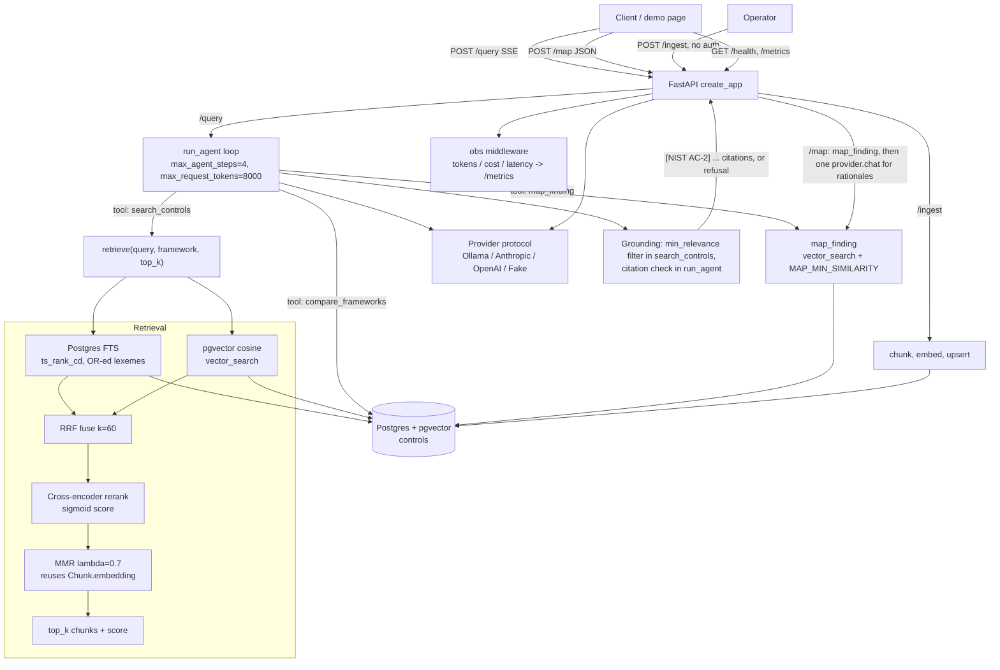

# Sentinel - Architecture

Sentinel is a grounded governance/compliance Q&A API over NIST 800-53, ISO 27001
Annex A and CIS v8. Every answer is traceable to a retrieved control chunk; when
nothing relevant is found, or the answer cites something that was not retrieved, it
refuses rather than fabricating.

## System diagram

## Request flows

- **POST /query** - Runs the `run_agent` loop through a `Provider`, then streams
  named SSE events: `token` (answer text, word by word), `citations`, `meta`
  (`steps`, `input_tokens`, `output_tokens`, `stop_reason`, `cost_usd`, and `trace`,
  the per-request tool trace) and `done`; or a single `refusal` event.
- **POST /map** - Body `{finding_text}`. Does not use the agent loop: it calls
  `map_finding`, which ranks controls across all frameworks by embedding cosine
  (`vector_search`, not the cross-encoder: MS-MARCO scores a declarative finding near
  0 even against the right control) and drops those below `map_min_similarity`
  (default 0.35; on the full corpus real findings top 0.41-0.64, off-topic text at
  most 0.33). Each control is listed once, at its best chunk. If none remain it returns `controls: []` with
  `refused: true` (counted as a refusal in `/metrics`) and makes no LLM call.
  Otherwise it makes one `provider.chat` call for a one-sentence rationale per
  control. The rationale JSON may be wrapped in a code fence and keyed with or
  without brackets; keys are normalised like citations. Returns JSON with
  `controls`, `citations`, `tool_trace`, token counts, `cost_usd` and `refused`. If
  the model gives no rationale for a control, the rationale says so honestly:
  `No model rationale; matched by retrieval (score 0.NN).`
- **POST /ingest** - Unauthenticated (no auth). Loads the corpus (NIST catalog plus
  YAML files under `corpus/`), chunks, embeds and upserts. Idempotent on
  `(framework, control_id, chunk_idx)`. Returns per-framework counts and a total.
  CI uses the fixtures `tests/fixtures/mini_nist.yaml`, `mini_iso.yaml` and
  `mini_cis.yaml`.
- **GET /health** - Liveness, returns `{"status": "ok"}`.
- **GET /metrics** - In-memory counters with exactly these keys: `total_requests`,
  `total_tokens`, `total_cost_usd`, `avg_latency_ms`, `refusals`.

A demo page is served as static files from `/` (mounted last so API routes win).

## Retrieval pipeline

`retrieve(query, framework, top_k)` runs one hybrid pass over a candidate pool of 20
per leg:

1. **FTS** - Postgres full text search ranked by `ts_rank_cd`. The `fts` column
   weights `framework + control_id + title` as A and `summary` as B. The query is
   built from `plainto_tsquery` (stemming, stopwords) with the lexemes OR-ed rather
   than AND-ed, so natural-language questions still match.
2. **vector** search - pgvector cosine distance (`vector_search`) on 384-dim
   embeddings (`sentence-transformers/all-MiniLM-L6-v2`).
3. **RRF** fusion - Reciprocal Rank Fusion with k=60 over the two rankings.
4. **rerank** - cross-encoder `cross-encoder/ms-marco-MiniLM-L-6-v2` (process-wide
   `lru_cache` singleton) scores pairs of the query and
   `"{title}. {summary} ({framework} {control_id})"` (label last: as a prefix it cut
   relevant scores sharply). The raw logit is squashed with a
   sigmoid into (0, 1) so it sits on the scale `min_relevance` is calibrated for.
5. **MMR** - greedy, lambda=0.7. The relevance term is each chunk's sigmoid rerank
   score (not query cosine); redundancy is the maximum cosine to the embeddings of
   already-selected chunks, reusing `Chunk.embedding` (no re-embedding). Returns
   `top_k` (default `retrieval_top_k=8`).

At ingest, the text embedded for each chunk is `"{title}. {summary-chunk}"`; the
stored `summary` is unchanged. Chunking is one chunk per control unless the summary
exceeds `max_chunk_tokens` (512, counted as whitespace-separated words).

## Grounding and refusal

Runtime grounding has two parts, with no separate judge LLM call:

- `search_controls` drops retrieved chunks whose score is below `min_relevance`
  (default 0.3).
- `run_agent` collects the `framework control_id` of every control returned by a tool
  call. When the model gives its final answer, the loop extracts citations of the
  form `[NIST AC-2]`, `[ISO A.5.15]`, `[CIS CIS-5]`. It refuses if there are no
  citations, or if any cited id was not returned by a tool call.

The loop also refuses with `stop_reason` `max_tokens` or `max_steps` when a cap is
hit. A refusal returns `REFUSAL_MESSAGE` and surfaces as the `refusal` SSE event.
`grounding.verify_grounded` exists but is not called at runtime.

## Agent loop

A hand-rolled `run_agent` loop drives tool use through the `Provider` protocol
(Ollama, Anthropic, OpenAI, or a deterministic `FakeProvider` for eval and tests).
It is capped by `max_agent_steps` (4) and `max_request_tokens` (8000, checked after
each round of tool calls), records a tool-call trace (`{tool, args, result_summary}`)
and sums input/output tokens per request. Tools: `search_controls`,
`compare_frameworks` (deterministic `get_by_control_id` lookup, then equivalents from
`corpus/mappings.yaml`) and `map_finding`. Prompts are versioned text files under
`app/prompts/` (`system.txt`, `map.txt`), loaded by `load_prompt`.

## Observability

A middleware (`MetricsMiddleware`) records, per request, latency, tokens, cost,
refusal flag and tool trace into an in-memory store, which backs `/metrics`. Cost
comes from a per-provider price table (`cost_for`); Ollama and the fake provider
cost 0. For `/query`, latency covers the agent run but not the SSE body replay.
The middleware also logs one `sentinel.obs` INFO line per request whose message is
JSON (`path`, `latency_ms`, `tokens`, `cost_usd`, `refused`, `tool_trace`);
`create_app` enables INFO for the `sentinel` loggers without reconfiguring an
existing logging setup.

## Data model

A single `controls` table: `id`, `framework`, `control_id`, `chunk_idx`, `title`,
`summary`, `source_url`, `embedding vector(384)`, and `fts tsvector` (a generated,
stored column). `UNIQUE (framework, control_id, chunk_idx)` supports idempotent
upsert; a GIN index covers `fts` and an HNSW index (`vector_cosine_ops`) covers
`embedding`.
